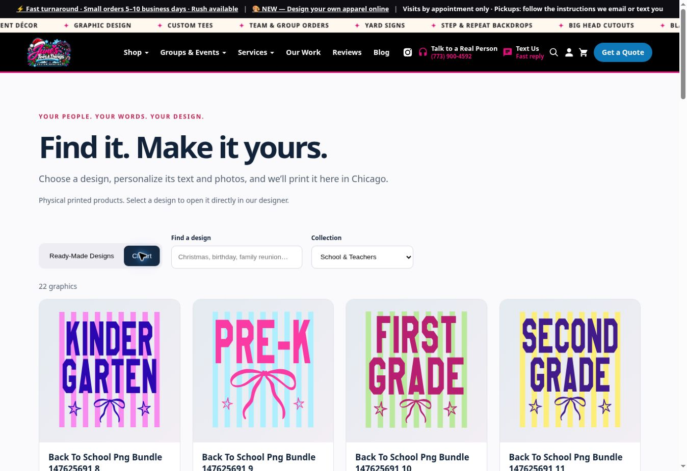

# Designer management in jtees admin

The customer gallery is `/shop-designs`; legacy `/design-ideas.html` and `/design-ideas` redirect there. `/admin/design-library` is the owner management page, with search, status/type/collection filters and 24 items per page. The customer gallery renders 48 items at a time.

`/admin/studio-controls` manages existing product names, descriptions, base prices, size/color labels and extras, defaults, availability, images and allowed decoration methods. Print-area previews support dragging and exact values, using the existing cross-colorway helper. `/admin/studio-controls?tab=pricing` edits existing decoration quantity ceilings, minimums and prices per location. Both surfaces write the existing Lumise records; no second price catalog is created. Product/method saves retain private pre-change snapshots and reject stale revisions.

Fonts have web (WOFF2) and PDF (TTF) attachments. New fonts stay disabled until both exist; originals are retained on replacement. PNG/JPEG artwork uploads start in draft. Mockups can be uploaded and their carousel order chosen per design without deleting source files. Per-design personalization switches further restrict bracketed text, photo slots and clipart recoloring; they do not unlock fixed artwork.

The clipart organizer adds useful category memberships from existing names, tags and categories; it retains existing memberships and artwork. The gallery reads its collection index, with manual collection choices taking precedence. Generic/ambiguous names are flagged for review. This categorization is a metadata-based first pass, not a claim that every image has been visually identified.

AI controls expose pause/resume, aggregate daily usage and a site attempt cap. The customer allowance remains five successful requests per Chicago day; failures release the customer allowance but consume the site cap. This is a request cap, not a dollar budget. No allowance identity hashes are exposed to the browser.

`/admin/design-requests` consolidates unquoted change requests and existing quote/art/proof states. It links to the existing assignment, files, messages, proofs and payment controls. It does not create duplicate job records or release work around the existing approval/payment gate. Library approval email respects notification preferences and shares the sweep's atomic email claim.

Validation includes authorization/refusal cases, query validation, upstream failure/conflict handling, exact cents, pagination across the full inventory, categorization, private storage and AI limits. Existing print-area regressions cover source preservation, scaled colorways, conflict refusal and idempotence. Andrea confirmed the editable PDF works in Affinity on November 17. Unsupported specialized decoration calculations and new full product structures use explicitly linked original-editor tools; routine management remains in jtees admin. Existing ready-made templates still need artwork-only previews before publication.

Implementation follows the existing Lumise category/reference tables and authenticated backend proxy. A search of GitHub and Reddit found compatible category-based Lumise integrations, but no suitable drop-in management extension for this standalone PHP installation. No new runtime dependencies or schema migrations were introduced.

## Verified live on November 17, 2026

Both services reached successful deployments. The live organizer sorted 4,281 clipart records; 4,279 remain publicly active. The complete admin inventory contains 4,466 designs and cliparts. Collection filters are available throughout the gallery and admin library; 1,683 generic/unclear names are flagged for review, and 97 records sit in Other Clipart. Original memberships, source files, and existing visibility are retained.

Checked the 520-product management list, the Gildan 5000 sizes and front/chest/back print areas, decoration pricing, the empty custom-font state, five-request AI screen, design-request queue, and gallery collection filtering. A School & Teachers graphic opened directly on its exact default product in the designer without automatic onboarding/popups. Design-approval email was enabled and its saved state verified. No customer order, payment or sample design request was submitted during these checks.

The old Design Ideas URL resolves to the customer gallery. Ready-made templates remain subject to artwork-preview preparation and owner publication. Andrea confirmed Affinity editable PDF import works.

Merged delivery branches:

- `radar/studio-admin-controls`: https://github.com/alwinte5-rgb/junesteesnthings-backend/pull/555 and https://github.com/alwinte5-rgb/lumise-designer/pull/262
- `radar/full-library-inventory`: https://github.com/alwinte5-rgb/lumise-designer/pull/263
- `radar/library-save-context`: https://github.com/alwinte5-rgb/junesteesnthings-backend/pull/556

Created implementation files in this workspace:

- /workspace/scratch/d5107195d3b6/backend/tools/lib/studio-controls.js
- /workspace/scratch/d5107195d3b6/backend/public/assets/js/studio-controls.js
- /workspace/scratch/d5107195d3b6/backend/public/assets/css/studio-controls.css
- /workspace/scratch/d5107195d3b6/backend/tests/studio-controls.test.js
- /workspace/scratch/d5107195d3b6/backend/docs/studio-admin-controls.md
- /workspace/scratch/d5107195d3b6/backend/docs/verification/sorted-clipart-gallery.jpg
- /workspace/scratch/d5107195d3b6/designer/jt-controls-settings.php
- /workspace/scratch/d5107195d3b6/designer/jt-controls-lib.php
- /workspace/scratch/d5107195d3b6/designer/jt-controls.php
- /workspace/scratch/d5107195d3b6/designer/tests/controls.test.php
- /workspace/scratch/d5107195d3b6/designer/tests/controls-mysql.test.php

## Artwork workspace and navigation completion

`/admin/artwork` uses the existing `art.work` staff permission. It shows company library artwork and direct links to assigned jobs, the designer, template/ready-made/clipart filters, name review and missing previews. Eleazr’s live staff profile already has `art.work` and `jobs.design` enabled; no staff permission changes or owner credentials are needed. Pricing, publication, AI settings and full product setup remain owner-only. Staff source/name/preview writes are draft-only and the proxy enforces that restriction independently of the browser. Private notes, submitter emails, prices and master-file metadata are excluded from the workspace feed.

The owner menu now includes a Designs & studio section with direct links to Artwork workspace, Design Library, Design requests, Designer controls, Products & print areas, Decoration pricing, Fonts, Collections & clipart, AI usage and Upload artwork. Library filters and the advanced existing product/pricing/font tools are visible links too.

Missing previews can be prepared sequentially without paid AI calls. It uses the existing Fabric renderer, validates source paths and PNGs, preserves saved screenshots and prices, and reports blank/corrupt/unsupported artwork for attention. It does not automatically approve a draft.

Validation: 145 selected backend checks pass, including route registration, staff roles, redaction, draft enforcement, conflicts, navigation and gallery rules. Nineteen bridge checks exercise the real PHP endpoint in isolated child processes, including missing keys, traversal, live-art refusal, populated-side selection and legacy encoding. Full designer CI and its MySQL integration passed.

Delivery branch `radar/design-navigation-access`: backend PR https://github.com/alwinte5-rgb/junesteesnthings-backend/pull/558 and designer PR https://github.com/alwinte5-rgb/lumise-designer/pull/264, both merged.

Additional created files:

- /workspace/scratch/d5107195d3b6/backend/tools/lib/artwork-workspace.js
- /workspace/scratch/d5107195d3b6/backend/public/assets/js/artwork-workspace.js
- /workspace/scratch/d5107195d3b6/backend/tests/artwork-workspace.test.js
- /workspace/scratch/d5107195d3b6/designer/jt-artwork.php
- /workspace/scratch/d5107195d3b6/designer/tests/artwork-bridge.test.php

## Stock availability and missing artwork sources

Owner route: /admin/studio-controls?tab=stock. Check stock now starts a stock-only S&S check; Refresh progress reads the result. Confirmed zero stock deactivates primary-S&S products, preserving source products, screenshots and prices. It counts all supplied sizes and warehouses independently of prices. Invalid quantities, supplier failures and Bella+Canvas with possible SanMar supply remain available for review. More than ten zero-stock products in one refresh are held for review. Existing selected-size checkout checks and the daily supplier sync remain unchanged. There is no automatic startup stock scan.

Missing local artwork sources are excluded from the public library feed, retained privately, and linked at /admin/artwork?missing=1. Files intentionally removed by the existing entrypoint are not restored. The native designer clipart picker is outside this change.

Validation: 93 selected Node checks passed. Designer PHP CI, MySQL integration and the repository gate passed for PR265. No authenticated production stock scan has been run in this session; no actual product deactivation count is claimed. Ten of 185 artwork previews still require the owner to rerun Prepare missing previews after the SVG/curved-text renderer fix. The previous run saved 175 previews.

Delivery: backend PR https://github.com/alwinte5-rgb/junesteesnthings-backend/pull/561 (radar/supplier-stock-availability); designer PR https://github.com/alwinte5-rgb/lumise-designer/pull/265 (radar/library-missing-sources).

Additional implementation files:

- /workspace/scratch/d5107195d3b6/backend/tools/lib/supplier-stock.js
- /workspace/scratch/d5107195d3b6/backend/tests/supplier-stock.test.js
- /workspace/scratch/d5107195d3b6/designer/jt-library-assets.php
- /workspace/scratch/d5107195d3b6/designer/tests/library-assets.test.php
